<div align="center">

# 🏥 Hospital de los Costeños con Narcolepsia

**Urgencias con sabor a Caribe y mucha siesta**

Sistema de gestión hospitalaria en Go para pacientes que se duermen sin aviso, con una interfaz gráfica 2D en pixel art.

Trabajo de Programación Orientada a Objetos · Universidad EIA

[](https://go.dev/)
[](go.mod)
[](web/js)
[](web/index.html)
[](#-pruebas-y-calidad)
[](web/assets/LICENSES.md)

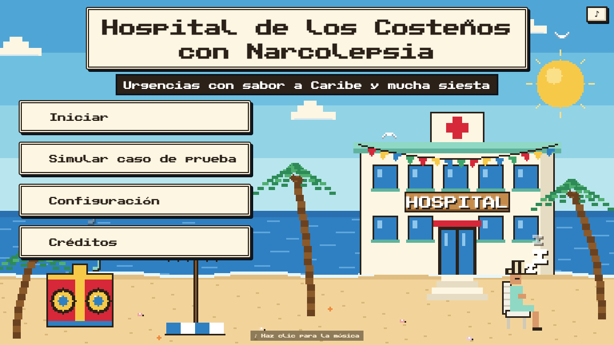

</div>

---

## 📑 Contenido

- [Descripción](#-descripción)
- [Capturas](#-capturas)
- [Tecnologías](#-tecnologías)
- [Inicio rápido](#-inicio-rápido)
- [Arquitectura](#-arquitectura)
- [Modelo de dominio](#-modelo-de-dominio)
- [Cómo funciona un ataque de sueño](#-cómo-funciona-un-ataque-de-sueño)
- [Interfaz gráfica](#-interfaz-gráfica-bonus)
- [API REST](#-api-rest)
- [Decisiones de diseño](#-decisiones-de-diseño)
- [Pruebas y calidad](#-pruebas-y-calidad)
- [Estructura del proyecto](#-estructura-del-proyecto)
- [Flujo de trabajo](#-flujo-de-trabajo)
- [Uso de IA](#-uso-de-ia)
- [Créditos](#-créditos)

---

## 📖 Descripción

En este hospital los pacientes sufren ataques de narcolepsia en cualquier lugar: en la cafetería, en la sala de espera o en mitad del pasillo. El sistema:

- **registra cada episodio** con su fecha, su ubicación y quién lo atendió;
- **asigna una cama** libre al paciente dormido o, si no hay, lo deja en el pasillo y en la **cola de habitaciones**;
- **despacha al personal** (doctores y camilleros) por turnos entre quienes estén libres o, si nadie lo está, deja al paciente en la **cola de atención**;
- **reparte las colas en orden FIFO** cada vez que alguien despierta y se libera una cama o un miembro del personal;
- responde las **cuatro consultas** del enunciado: pacientes dormidos en el pasillo, episodios por doctor, asignación sin habitación disponible y reporte de severidad.

Incluye los dos bonus del enunciado:

- 🎮 **Interfaz gráfica**: una API REST y un frontend HTML/JS en canvas, sin cambiar ni una línea del paquete `hospital`.
- ⚡ **Simulación concurrente**: una goroutine por paciente y el estado protegido con `sync.Mutex`. Corre limpia con `-race`.

---

## 📸 Capturas

<table>
  <tr>
    <td width="50%">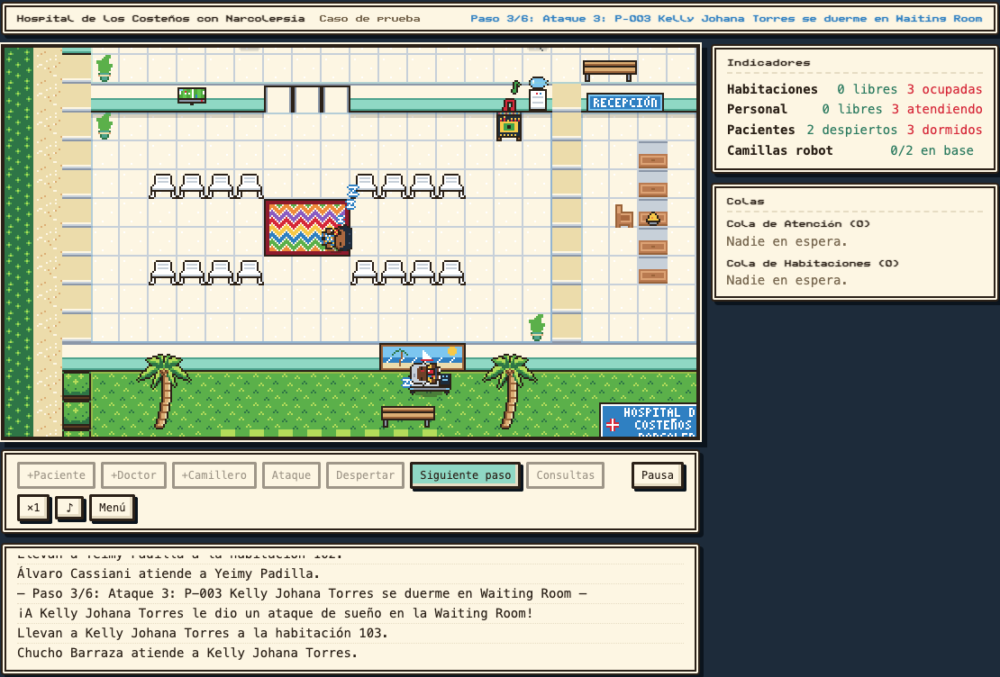</td>
    <td width="50%">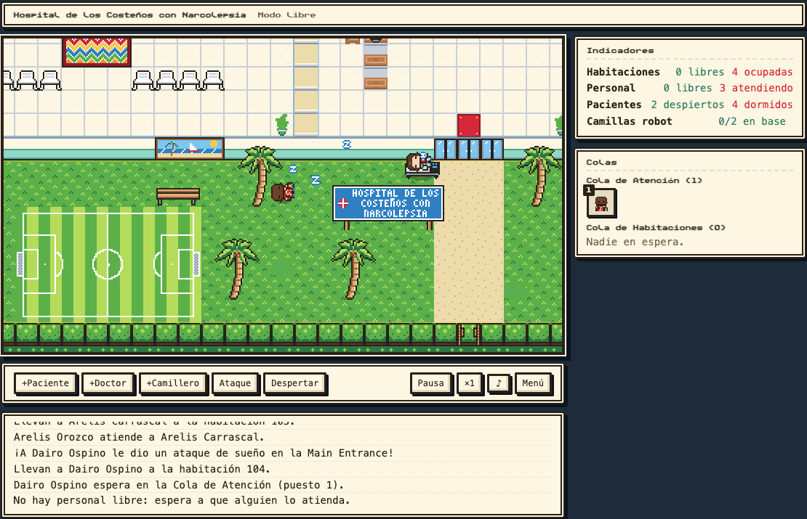</td>
  </tr>
  <tr>
    <td align="center"><b>Caso de prueba paso a paso.</b> Kelly se duerme en la sala de espera y la llevan a la 103.</td>
    <td align="center"><b>Modo libre.</b> No hay personal libre y Dairo espera en la cola de atención.</td>
  </tr>
  <tr>
    <td>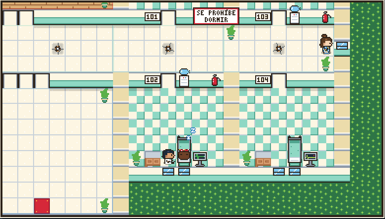</td>
    <td>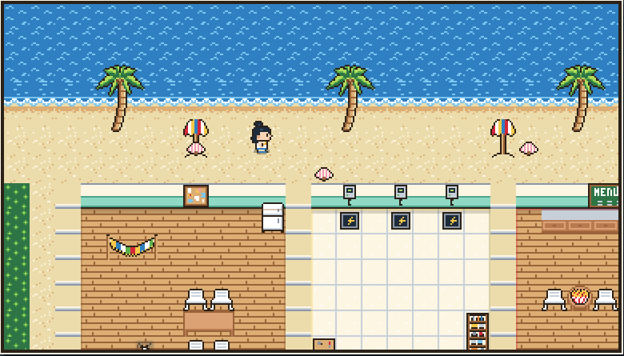</td>
  </tr>
  <tr>
    <td align="center"><b>Habitaciones.</b> Atención en la 102, con el letrero de «SE PROHÍBE DORMIR» en el pasillo.</td>
    <td align="center"><b>A la orilla del mar.</b> Sala de personal, base de robots y cafetería.</td>
  </tr>
  <tr>
    <td>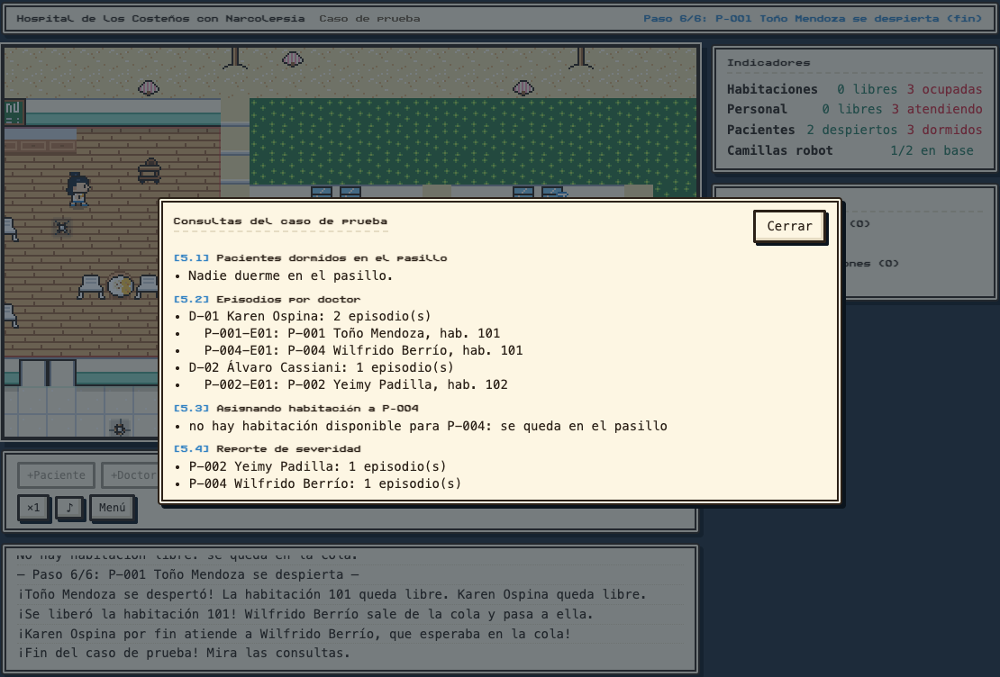</td>
    <td>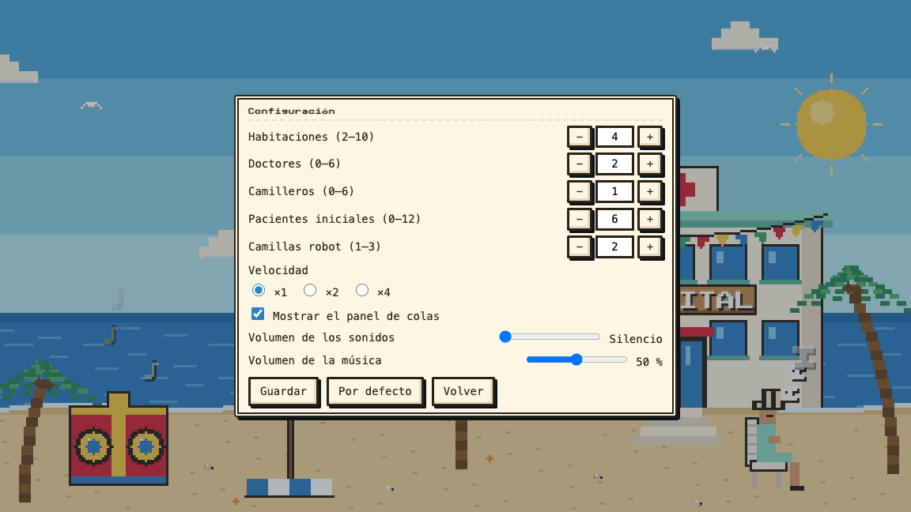</td>
  </tr>
  <tr>
    <td align="center"><b>Las cuatro consultas</b> (<code>[5.1]</code> a <code>[5.4]</code>) al terminar el caso de prueba.</td>
    <td align="center"><b>Configuración.</b> Habitaciones, personal, robots, velocidad y volumen.</td>
  </tr>
</table>

---

## 🧰 Tecnologías

| Capa | Tecnología | Para qué |
|---|---|---|
| **Lógica** | Go 1.27, solo la biblioteca estándar | El paquete `hospital`: entidades, colas, despacho y consultas |
| **Concurrencia** | `sync.Mutex` y goroutines | Simulación con un paciente por goroutine, sin carreras de datos |
| **API** | `net/http` (rutas con método, Go 1.22+), `encoding/json` | Adaptador REST entre la lógica y la vista |
| **Empaquetado** | `embed` (`//go:embed`) | El frontend va dentro del binario: un solo `go run` |
| **Frontend** | HTML5 Canvas, CSS y JavaScript (ES modules) | Mapa, personajes animados y paneles. Sin npm, sin bundler y sin CDN |
| **Algoritmos** | A\* en JavaScript | Caminos de pacientes, personal y camillas robot por el mapa |
| **Audio** | Web Audio API y `<audio>` | Efectos de sonido y música de fondo opcional |
| **Sprites** | `image/png` (Go) | `tools/spritegen` dibuja los sprites propios a partir de grillas de texto |
| **Pruebas** | `go test`, `-race`, `httptest`, `node --test` | Lógica, API, generador de sprites y frontend |
| **Arte de terceros** | Kenney, Ninja Adventure y Public Pixel (CC0) | Muebles, plantas, emotes y fuente pixel |
| **Control de versiones** | Git con gitflow | Ramas `feature/*`, `release/*` y tags semánticos |

---

## 🚀 Inicio rápido

**Requisitos:** Go 1.27 o superior. Para las pruebas del frontend, Node 22 (opcional).

```sh
git clone git@github.com:apnauj/narcolepsyHospital.git
cd narcolepsyHospital
```

### Programa de consola

```sh
go run .            # menú: 1 = escenario de demostración, 2 = menú interactivo
go run -race .      # lo mismo, con el detector de carreras
```

- La opción **1** ejecuta exactamente el escenario de la sección 6 del enunciado e imprime las cuatro consultas, marcadas como `[5.1]` a `[5.4]`.
- La opción **2** abre un menú sobre los mismos datos iniciales. Ahí se pueden provocar ataques, despertar pacientes, asignar camas, hacer las consultas y lanzar la simulación concurrente.

### Interfaz gráfica

```sh
go run ./cmd/gui                  # abre http://localhost:8080
go run ./cmd/gui -addr :9000      # en otro puerto
```

### Pruebas

```sh
go test ./...                              # pruebas de Go
go test -race ./...                        # incluida la simulación concurrente, con el detector de carreras
cd web && node --test "test/*.test.js"     # pruebas del frontend (Node 22)
```

---

## 🏗 Arquitectura

Las dependencias van en **una sola dirección**. El paquete `hospital` no importa nada del proyecto, no imprime nada y no sabe que existe una interfaz.

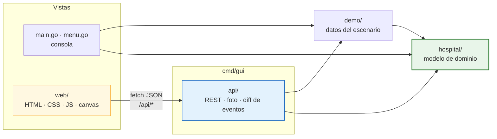

**Separación entre lógica y vista.** Es lo que premia el bonus (sección 7 del enunciado): *el paquete `hospital` no debe cambiar al agregar la interfaz*. Se puede comprobar con:

```sh
git diff v1.0.0 -- hospital/     # vacío: la interfaz se agregó después de v1.0.0
```

Para lograrlo, la API **no usa callbacks ni observadores dentro del modelo**. Antes y después de cada comando toma una foto del estado público, con los mismos getters que usaría cualquier cliente, y la vista recibe los eventos que salen de comparar las dos fotos:

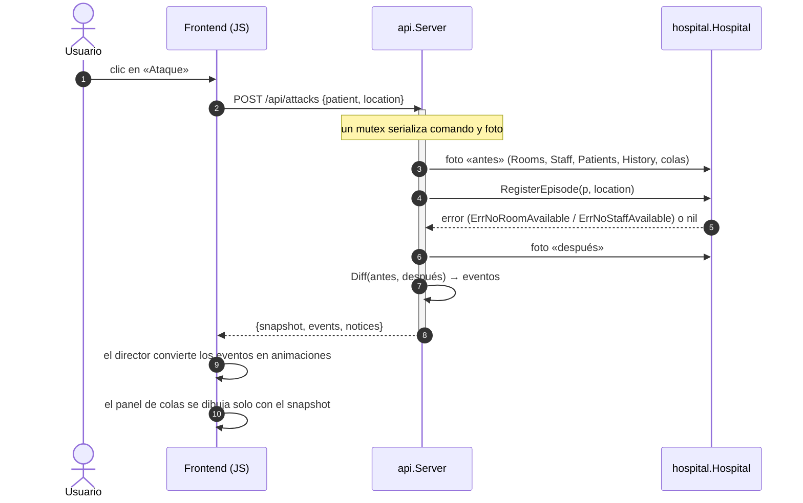

---

## 🧬 Modelo de dominio

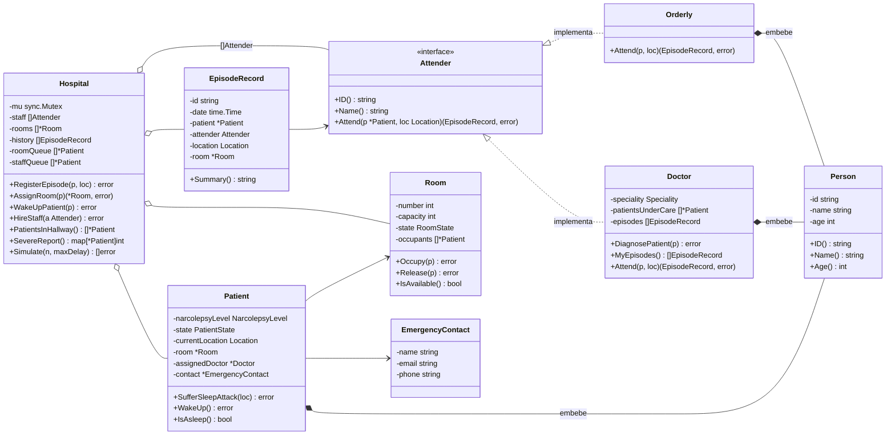

**Estados del paciente.** Son constantes tipadas (`PatientState`) con `String()`:

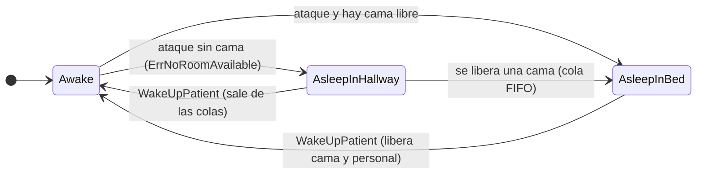

---

## 😴 Cómo funciona un ataque de sueño

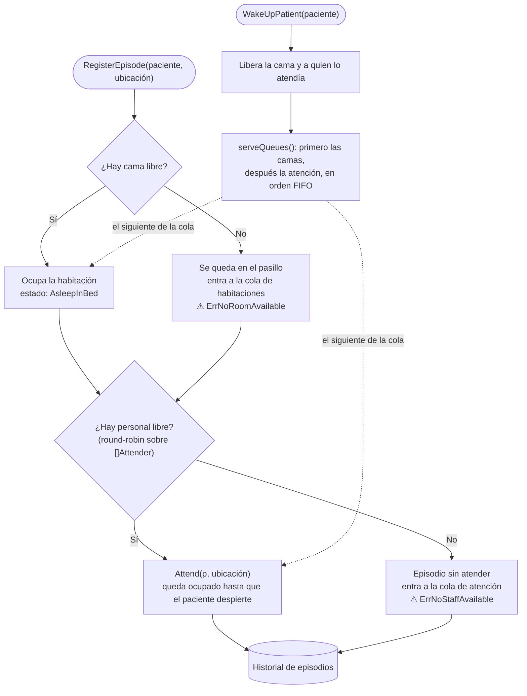

En el escenario de demostración hay 3 habitaciones, 2 doctores y 1 camillero, y se duermen cuatro pacientes. El cuarto, Wilfrido (P-004), se queda sin cama y sin personal. La consulta `[5.3]` muestra el error. Cuando Toño despierta, la cola le pasa a Wilfrido la habitación 101 y a Karen Ospina.

---

## 🎮 Interfaz gráfica (bonus)

Es un mapa 2D en pixel art del hospital, generado según la configuración: de 2 a 10 habitaciones, con alas en L o en U cuando son muchas. Está a la orilla del mar y tiene palmeras, cafetería costeña y canchita de fútbol.

| Modo | Qué hace |
|---|---|
| **Iniciar** | Modo libre: agrega pacientes, doctores y camilleros, provoca ataques y despierta a cualquier paciente dormido |
| **Simular caso de prueba** | El mismo escenario de `go run .`, paso a paso, con las cuatro consultas al final |
| **Configuración** | Habitaciones, personal inicial, de 1 a 3 camillas robot, velocidad ×1/×2/×4, panel de colas y volumen |
| **Créditos** | Quién hizo el proyecto y qué se usó |

**Lo que se ve en pantalla:**

- **Panel de colas** con los retratos en orden. Sale directamente de `WaitingForRoom()` y `WaitingForStaff()`, así que siempre coincide con la lógica.
- **Indicadores** de habitaciones, personal, pacientes y camillas robot.
- **Registro** de lo que pasa, escrito letra por letra.
- **Ficha** de cada persona al hacer clic sobre ella.
- **Personajes por capas:** piel, ropa (incluida la camiseta de la Selección Colombia), peinado o sombrero vueltiao y accesorios.
- **Animaciones** de caminar, dormirse, estar en cama y despertar, con partículas `Zzz` y `!`, globos de diálogo y decoración animada: TV, monitor cardíaco, ventiladores y picó.
- **Camillas robot**, que son solo visuales. Muestran cómo llega a su cama un paciente que consiguió habitación sin que nadie lo atienda.

**Controles:**

| Acción | Control |
|---|---|
| Mover la cámara | flechas o `WASD`, o arrastrar con el mouse |
| Zoom ×1 / ×2 | `Z` |
| Ver la ficha de alguien | clic sobre la persona |
| Pausa, velocidad, música | botones de la barra inferior |

**Sprites propios.** Personajes, camas, monitores, silla Rimax, picó, comida (salchipapas, cerveza Águila, arroz de coco con patacones), cancha, letreros y camilla robot. Los genera `go run ./tools/spritegen` a partir de grillas de texto en `tools/spritegen/src/`, con una paleta Caribe compartida. El formato de las hojas está en [`docs/gui/SPRITESHEETS.md`](docs/gui/SPRITESHEETS.md).

<div align="center">
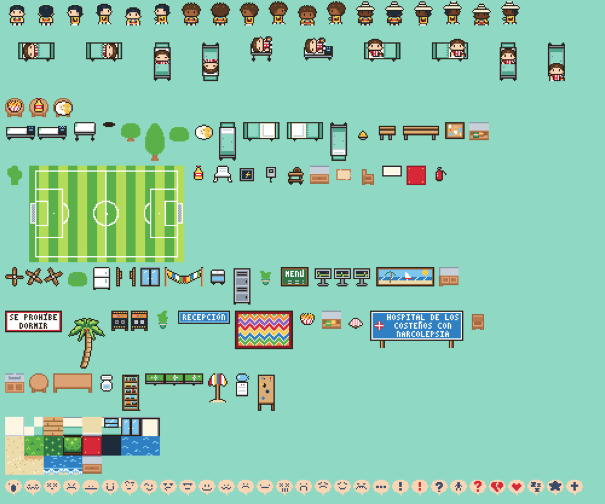
</div>

**Música.** Arranca con el primer clic o tecla, porque los navegadores no permiten reproducir sonido antes, y se silencia con el botón ♪. El archivo **no está en el repositorio**: para escucharla, coloca un mp3 en `web/assets/audio/musica.mp3`, que git ignora. Sin él, la interfaz funciona igual, en silencio.

El contrato completo entre la API y el frontend está en [`docs/gui/CONTRACT.md`](docs/gui/CONTRACT.md).

---

## 🔌 API REST

Todas las respuestas son JSON y los arreglos nunca vienen en `null`. Los comandos devuelven `{snapshot, events, notices}`.

| Método | Ruta | Descripción |
|---|---|---|
| `GET` | `/api/state` | Foto completa: habitaciones, personal, pacientes, `roomQueue` y `staffQueue` |
| `GET` | `/api/locations` | Catálogo de ubicaciones válidas (`hospital.Location`) |
| `GET` | `/api/queries` | Las cuatro consultas del enunciado |
| `POST` | `/api/reset` | Reinicia el hospital con una configuración (habitaciones, personal y pacientes) |
| `POST` | `/api/patients` | Admite un paciente nuevo |
| `POST` | `/api/staff` | Contrata un doctor o un camillero |
| `POST` | `/api/attacks` | Provoca un ataque de sueño en una ubicación |
| `POST` | `/api/wakeups` | Despierta a un paciente |
| `POST` | `/api/scenario/start` | Prepara el escenario de demostración |
| `POST` | `/api/scenario/next` | Ejecuta el siguiente paso del escenario |

**Eventos** que salen del diff, en orden fijo: `patientAdmitted`, `staffHired`, `patientWoke`, `attackStarted`, `roomAssigned`, `queuedForRoom`, `attentionAssigned` y `queuedForStaff`.

---

## 🧠 Decisiones de diseño

- **Encapsulación.** Todos los campos están en minúscula. Desde fuera del paquete solo se accede con métodos, y los métodos que devuelven slices entregan copias.
- **Composición.** `Person` se embebe por valor en `Patient`, `Doctor` y `Orderly`. Así los tres reciben `ID()` y `Name()` sin repetir campos, y `Doctor` y `Orderly` cumplen parte de `Attender` con esos métodos promovidos.
- **Polimorfismo.** El hospital guarda su personal en un `[]Attender` y despacha por turnos (round-robin) entre quienes estén libres.
  - Quien atiende un ataque queda ocupado hasta que su paciente despierta, así que el despacho se lo salta.
  - Si nadie está libre, el episodio se registra sin atender y se devuelve `ErrNoStaffAvailable`.
  - El hospital nunca pregunta por el tipo concreto. Para añadir un tipo nuevo, por ejemplo una enfermera, basta con implementar la interfaz y llamar a `HireStaff`.
- **Colas de espera.** Quien se duerme sin cama entra a la cola de habitaciones, y quien se duerme sin nadie libre entra a la cola de atención.
  - Las dos son FIFO (slices) y las reparte `serveQueues` cada vez que algo se libera: cuando un paciente despierta, se agrega una habitación o se contrata personal.
  - Primero se reparten las camas, para que el registro de quien por fin es atendido ya incluya su habitación.
  - El episodio que estaba en el historial sin atender se reemplaza por el de quien lo atendió, así que el reporte de severidad no lo cuenta dos veces.
  - Si un paciente que espera se despierta, sale de las colas.
- **Errores.** Ningún caso previsto entra en pánico. La falta de cama es el error centinela `ErrNoRoomAvailable` y se detecta con `errors.Is`. `RegisterEpisode` deja el episodio registrado aunque no haya cama.
- **Estados.** Los estados y niveles son constantes tipadas con `String()`. `Location` también es un tipo, para evitar errores al escribir los nombres de las ubicaciones. Por eso `Attend` recibe un `Location` y no un `string`.
- **Consultas.** Devuelven datos (`[]*Patient`, `[]EpisodeRecord`, `map[*Patient]int`), y toda la impresión ocurre en `main`. `SevereReport` incluye también a los pacientes Severe sin episodios.
- **Historial por doctor.** Cada `Doctor` guarda sus propios `EpisodeRecord`, de modo que `MyEpisodes` no necesita recibir al hospital.
- **Concurrencia.** `Hospital` tiene un `sync.Mutex` que toman todos sus métodos exportados.
  - Si dos goroutines intentan asignar la misma habitación a la vez, la segunda espera, encuentra la cama ocupada y busca otra o recibe `ErrNoRoomAvailable`.
  - Los métodos internos (`assignRoom`, `dispatch`, `hire`) asumen que el lock ya está tomado. Así un método exportado puede usar otro sin bloquearse a sí mismo.
  - Los métodos de `Patient` y `Room` no se protegen solos: en código concurrente se usan a través del hospital, por ejemplo con `WakeUpPatient`.
- **Interfaz desacoplada.** La API trabaja con fotos y diffs del estado público en vez de agregar observadores al modelo. Así `hospital` no tiene ni una línea de presentación.

---

## ✅ Pruebas y calidad

| Suite | Qué cubre |
|---|---|
| `hospital/hospital_test.go` | Asignación con y sin cama, despacho que salta al personal ocupado, colas FIFO, consultas y simulación concurrente |
| `api/*_test.go` | Los cuatro casos por HTTP, colas iguales a `WaitingFor*`, orden de los eventos y peticiones concurrentes con `-race` |
| `tools/spritegen/*_test.go` | Grillas, paleta, hojas generadas, que la salida sea determinista y que los PNG del repositorio estén al día |
| `web/test/*.test.js` | 187 pruebas: generador del mapa, A\*, cámara, director de animaciones, paneles, sprites y créditos |

Antes de cada versión se verifica:

```sh
gofmt -l .             # sin salida
go vet ./...           # sin advertencias
go test -race ./...    # todo en verde
git diff v1.0.0 -- hospital/   # vacío
```

---

## 📂 Estructura del proyecto

```
.
├── main.go              escenario de demostración e impresión de las consultas
├── menu.go              menú interactivo por consola
├── hospital/            modelo de dominio: no imprime nada ni sabe nada de la interfaz
│   ├── person.go            Person, embebida en Patient, Doctor y Orderly
│   ├── patient.go           Patient y sus estados (PatientState, NarcolepsyLevel)
│   ├── doctor.go            Doctor (implementa Attender)
│   ├── orderly.go           Orderly, el camillero (implementa Attender y no diagnostica)
│   ├── attender.go          interfaz Attender
│   ├── room.go              Room y RoomState
│   ├── episode.go           EpisodeRecord
│   ├── emergency_contact.go EmergencyContact (email y/o teléfono)
│   ├── location.go          Location: ubicaciones como constantes tipadas
│   ├── hospital.go          Hospital: operaciones, colas y consultas
│   ├── simulation.go        simulación concurrente (bonus)
│   └── hospital_test.go
├── demo/                datos del escenario, compartidos por la consola y la interfaz
├── api/                 API REST: snapshot, diff de eventos y comandos
├── cmd/gui/             servidor de la interfaz gráfica
├── web/                 frontend embebido en el binario
│   ├── js/world/            generador del mapa, A*, cámara
│   ├── js/entities/         personajes, tareas y director de animaciones
│   ├── js/ui/               paneles, registro, fichas y música
│   ├── js/scenes/           menú, configuración, juego, caso de prueba y créditos
│   ├── js/art/              render de sprites por capas
│   ├── js/fx/               partículas, decoración animada y sonido
│   ├── assets/              sprites generados, packs CC0 y LICENSES.md
│   └── test/                pruebas con node --test
├── tools/spritegen/     generador de sprites propios (solo biblioteca estándar)
└── docs/
    ├── trabajo go.md        enunciado
    ├── gui/                 contrato de la API y formato de las hojas de sprites
    └── img/                 capturas de este README
```

---

## 🌿 Flujo de trabajo

El proyecto se desarrolló con **gitflow**. El diagrama está simplificado: cada versión pasó por su rama `release/x.y.z` y hubo una rama `feature/*` por cada parte de la interfaz.

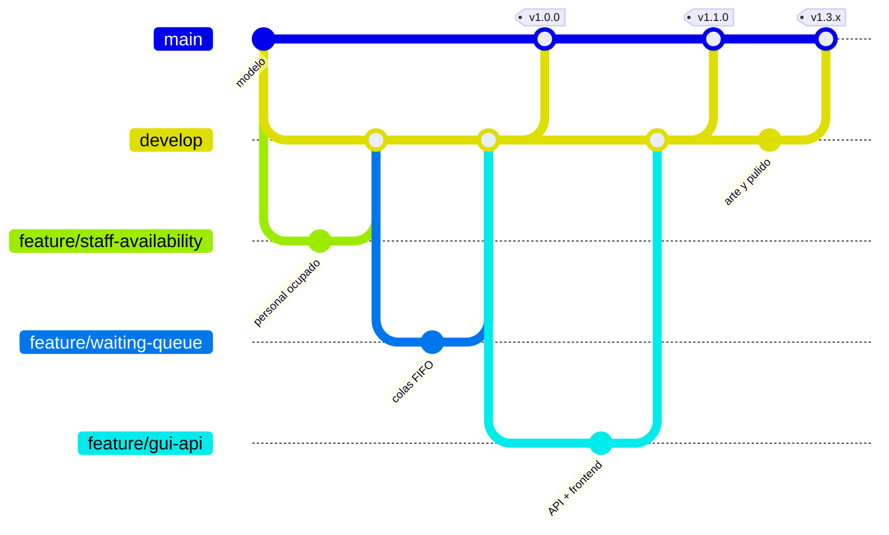

| Versión | Contenido |
|---|---|
| `v1.0.0` | Lógica completa: modelo, colas FIFO, consultas, consola y simulación concurrente |
| `v1.1.0` | Interfaz gráfica funcional (API REST, mapa, entidades y paneles) |
| `v1.2.0` | Arte pixel art, efectos, sonido y documentación de la interfaz |
| `v1.3.x` | Correcciones visuales, comida costeña, cancha, playa, menú decorado, créditos y AI_USAGE |

---

## 🤖 Uso de IA

El desarrollo se apoyó en **Claude Code** (Claude Opus 5.5 y Sonnet 5.5). Las herramientas usadas, los prompts decisivos, los errores del código generado y cómo se corrigieron están documentados con honestidad en [`AI_USAGE.md`](AI_USAGE.md).

---

## 🎨 Créditos

| Recurso | Autor | Licencia |
|---|---|---|
| [Roguelike Indoors](https://kenney.nl/assets/roguelike-indoors) (muebles) | Kenney | CC0 1.0 |
| [Roguelike/RPG pack](https://kenney.nl/assets/roguelike-rpg-pack) (plantas) | Kenney y Lynn Evers | CC0 1.0 |
| [Ninja Adventure](https://pixel-boy.itch.io/ninja-adventure-asset-pack) (emotes) | Pixel-boy y AAA | CC0 1.0 |
| [Public Pixel](https://ggbot.itch.io/public-pixel-font) (fuente) | GGBotNet | CC0 1.0 |

El detalle está en [`web/assets/LICENSES.md`](web/assets/LICENSES.md). Todo lo demás (sprites costeños, personajes y objetos) es propio.

<div align="center">

**Autor:** Juan Pablo Alzate · **Profesor:** Sebastián Zapata Ramírez

Programación Orientada a Objetos · Universidad EIA · 2026

</div>
